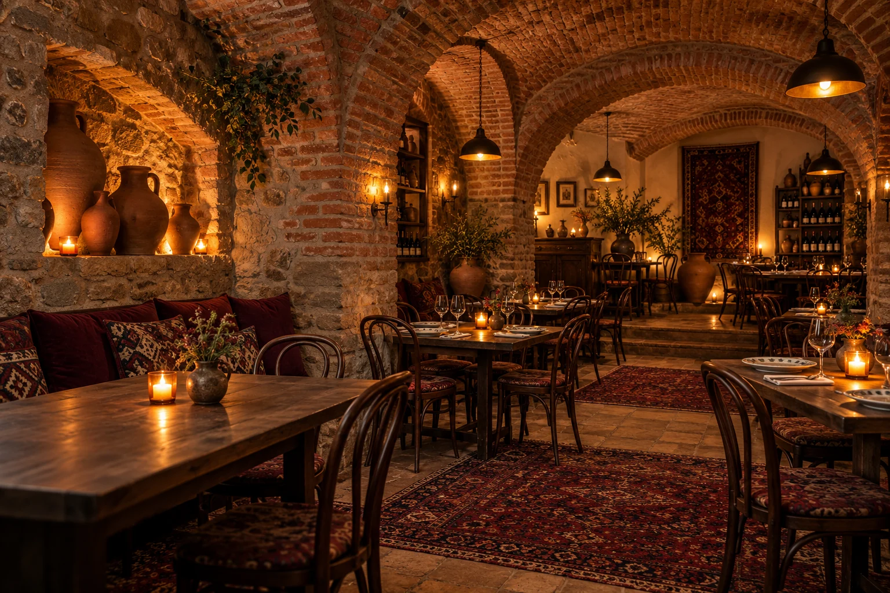

# Marani Cellar

A responsive Georgian restaurant demo website inspired by the warm brick cellars, traditional food, and qvevri wine of Old Tbilisi.



## Features

- English and Georgian language switch with a saved language preference.
- Categorized menu, quantity controls, and a cart that prepares an order for WhatsApp.
- Call, WhatsApp, and directions links, plus a fixed action bar on mobile.
- Five-image gallery with enlarged photo views and descriptive alternative text.
- Opening hours, sample guest reviews, and an embedded Google map.
- Responsive layouts, reduced-motion support, and Restaurant structured data.
- Six locally stored AI-generated WebP images, with generation prompts documented alongside them.

## Preview locally

No build step or package installation is required. Open `index.html` directly in a browser, or serve this directory with Python:

```bash
python3 -m http.server 8000
```

Then open http://localhost:8000.

Google Fonts, the embedded map, and outgoing service links require an internet connection. The restaurant images are included locally.

## Customize

Edit the `CONFIG` block in `index.html` to change the restaurant name, contact details, address, links, colors, images, menu, hours, reviews, and translations. Styling and behavior are contained in the same file.

The current palette matches the generated images:

| Role | Color |
| --- | --- |
| Main brand — warm brick brown | `#6B3A24` |
| Accent — honey gold | `#D9A441` |
| Background | `#F6F2EF` |
| Text | `#231A1D` |

Keep the CSS `:root` color defaults in sync with `CONFIG.colors` when changing the palette. The hero image preload in the document head should also match `CONFIG.hero` if replacing that image.

## Project files

```text
index.html
assets/images/
  hero-cellar.webp
  georgian-feast.webp
  khinkali.webp
  khachapuri.webp
  qvevri-wine.webp
  cellar-table.webp
  GENERATION.md
```

Built with HTML, CSS, and vanilla JavaScript. There is no backend; WhatsApp orders open a prepared message for the visitor to send.

## Demo content

The phone number, contact links, restaurant details, ratings, and reviews are sample content. Replace them with verified information before using this site for a real business. The generated images illustrate the demo concept and do not document an actual restaurant. See [image generation prompts](assets/images/GENERATION.md).

Website by Rajnish.
